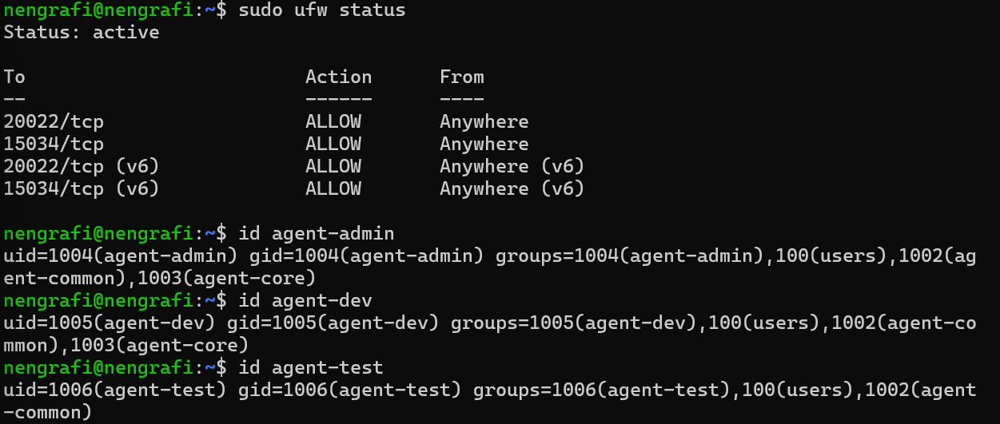

# 컴퓨터가 알아서 자기 상태를 점검하게 만들기

> **Codyssey Basic B4-1** · AI/SW 기초 · Linux와 OS<br>
> Ubuntu 22.04 LTS 환경에서 보안, 권한, 실행 환경, 모니터링을 하나의 운영 흐름으로 구성한 과제입니다.

## 1. 프로젝트 소개

서버 장애는 애플리케이션이 멈춘 뒤에 발견하면 복구 비용이 커집니다. 이 과제에서는 단순히 프로그램을 실행하는 데서 그치지 않고, **누가 서비스에 접근할 수 있는지**, **어떤 경로에 쓸 수 있는지**, **프로세스·포트·방화벽이 정상인지**를 스스로 점검하고 기록하는 환경을 만들었습니다.

핵심 목표는 다음과 같습니다.

- SSH 공격 표면을 줄이고 root 원격 로그인을 차단한다.
- 역할별 계정·그룹·ACL로 최소 권한을 적용한다.
- 서비스 실행에 필요한 경로와 포트를 환경 변수로 고정한다.
- Bash 기반 `monitor.sh`가 서비스 상태와 자원 사용량을 수집해 로그로 남긴다.
- 반복 실행할 수 있는 cron 운영 방식을 문서화한다.

## 2. 전체 구성

```text
외부 관리자
    │
    ├─ SSH :20022 ──> sshd (PermitRootLogin no)
    │
    └─ TCP :15034 ──> Agent application
                              │
agent-admin ── 실행/운영 ──────┤
agent-dev   ── 개발/스크립트 ──┤── /home/agent-admin/agent-app
agent-test  ── QA ────────────┘       ├── upload_files/  (agent-common)
                                      ├── api_keys/      (agent-core)
                                      └── bin/monitor.sh
                                                │
                                                └── /var/log/agent-app/monitor.log
```

| 구분 | 적용 내용 | 목적 |
| --- | --- | --- |
| 네트워크 보안 | SSH `20022`, root SSH 로그인 차단, UFW 허용 포트 최소화 | 무차별 대입 공격과 불필요한 노출 감소 |
| 계정·권한 | `agent-admin`, `agent-dev`, `agent-test`와 `agent-common`, `agent-core` 분리 | 역할 기반 최소 권한 적용 |
| 실행 환경 | `AGENT_HOME`, 포트, 업로드·키·로그 경로를 명시 | 실행 위치가 달라도 같은 조건으로 배포 |
| 상태 점검 | 프로세스·포트·방화벽·CPU·메모리·디스크 확인 | 장애를 빠르게 발견하고 추적 가능한 기록 확보 |

## 3. 구현 및 검증

### 3.1 SSH 보안 강화

기본 SSH 포트를 `20022`로 변경하고 `PermitRootLogin no`를 적용했습니다. 포트를 바꾸는 것만으로 공격을 막을 수는 없지만, 흔한 스캔·무차별 대입 시도를 줄이고 운영 계정으로의 접속을 강제하는 기본 방어층이 됩니다. root 계정이 직접 노출되지 않으므로, 작업 이력도 일반 운영 계정을 기준으로 남길 수 있습니다.

```bash
sudo sshd -T | grep -E '^(port|permitrootlogin) '
sudo ss -ltnp | grep ':20022'
```


### 3.2 UFW로 필요한 포트만 허용

방화벽은 활성화한 뒤 SSH용 `20022/tcp`와 애플리케이션용 `15034/tcp`만 허용했습니다. 방화벽 규칙을 애플리케이션의 실제 listen 포트와 함께 검증해야, 설정 파일에는 열려 있어도 서비스가 닫혀 있거나 반대로 불필요하게 노출되는 상황을 피할 수 있습니다.

```bash
sudo ufw status
```



### 3.3 역할 기반 계정·그룹·ACL

| 계정 | 담당 역할 | 소속 보조 그룹 |
| --- | --- | --- |
| `agent-admin` | 애플리케이션 실행, 운영, 주기 실행 담당 | `agent-common`, `agent-core` |
| `agent-dev` | 개발 및 `monitor.sh` 관리 | `agent-common`, `agent-core` |
| `agent-test` | QA·테스트 데이터 확인 | `agent-common` |

`agent-common`은 여러 역할이 협업하는 업로드 공간에만 사용하고, 키와 운영 로그처럼 민감한 자원은 `agent-core`로 분리했습니다. 이 구분 덕분에 테스트 계정이 업로드 파일은 다룰 수 있어도 API 키나 운영 로그에 접근하는 일은 막을 수 있습니다.

```text
$AGENT_HOME/
├── agent-app-linux-x86
├── api_keys/        # agent-core 전용
├── bin/             # monitor.sh
└── upload_files/    # agent-common 협업 영역

/var/log/agent-app/  # agent-core 운영 로그 영역
```


`upload_files`에는 setgid와 기본 ACL을 적용해 새 파일·하위 디렉터리도 `agent-common` 그룹 권한을 이어받도록 구성했습니다. 매번 파일을 만든 뒤 `chgrp`를 실행하지 않아도 되므로 협업 경로의 권한 일관성을 유지할 수 있습니다.

```bash
getfacl /home/agent-admin/agent-app/upload_files
```


### 3.4 애플리케이션 실행 환경

실행 환경은 경로와 포트를 코드에 흩어 쓰지 않고 아래 계약으로 관리했습니다. 키의 실제 값은 문서나 저장소에 노출하지 않습니다.

```bash
export AGENT_HOME=/home/agent-admin/agent-app
export AGENT_PORT=15034
export AGENT_UPLOAD_DIR="$AGENT_HOME/upload_files"
export AGENT_KEY_PATH="$AGENT_HOME/api_keys"
export AGENT_LOG_DIR=/var/log/agent-app
```

배포 앱은 일반 계정(`agent-admin`)으로 실행합니다. 시작 시 사용자, 필수 환경 변수, 키 파일, `15034` 포트, 로그 디렉터리 쓰기 권한을 순서대로 검사하고, 다섯 단계가 모두 통과해야 `Agent READY`를 출력합니다.


### 3.5 `monitor.sh`으로 상태 수집

[`agent-app/bin/monitor.sh`](agent-app/bin/monitor.sh)는 Bash로 작성한 운영 점검 스크립트입니다. 대상 앱은 `agent-app-linux-x86`, 대상 포트는 `15034`, 지표 로그 경로는 `/var/log/agent-app/monitor.log`로 설정했습니다.

| 점검 항목 | 방식 | 이상 시 동작 |
| --- | --- | --- |
| 프로세스 | `pgrep -fo agent-app-linux-x86` | 프로세스가 없으면 오류 종료 |
| 포트 | `ss -lntH`에서 `15034` LISTEN 확인 | 포트가 없으면 오류 종료 |
| 방화벽 | UFW 서비스 활성 상태 확인 | 운영자가 즉시 확인할 수 있도록 상태 출력 |
| CPU | `/proc/stat`을 1초 간격으로 비교 | `20%` 이상이면 경고 |
| 메모리 | `free -m` | `10%` 이상이면 경고 |
| 루트 디스크 | `df -P /` | `80%` 이상이면 경고 |

정상 점검 결과는 시간, PID, CPU, 메모리, 디스크 사용률과 함께 지표 로그에 추가됩니다. 헬스 체크를 먼저 통과시킨 뒤 자원을 기록하므로, 죽어 있는 서비스의 수치를 정상으로 오해하지 않습니다.

```bash
cd "$AGENT_HOME"
./bin/monitor.sh
```


표준 출력은 별도 실행 이력으로도 남겨 반복 실행 여부를 확인했습니다. 아래 화면은 프로젝트 내부 `monitor.log`에 모인 실행 결과입니다. 이는 `/var/log/agent-app/monitor.log`의 원본 지표 로그와 용도가 다른 운영 확인용 출력 기록입니다.


## 4. 실행과 재검증 방법

서비스는 root가 아닌 `agent-admin`으로 실행합니다. 애플리케이션과 모니터를 각각 다른 터미널에서 실행하면 상태 변화를 바로 확인할 수 있습니다.

```bash
# 터미널 1: agent-admin
export AGENT_HOME=/home/agent-admin/agent-app
cd "$AGENT_HOME"
./agent-app-linux-x86

# 터미널 2: agent-admin
cd "$AGENT_HOME"
./bin/monitor.sh
tail -n 20 /var/log/agent-app/monitor.log
```

다음 명령으로 보안과 권한도 함께 재검증합니다.

```bash
sudo sshd -T | grep -E '^(port|permitrootlogin) '
sudo ss -ltnp | grep ':20022'
sudo ufw status

id agent-admin
id agent-dev
id agent-test
getfacl "$AGENT_HOME/upload_files"
```

### cron 등록 방식

주기 실행은 `agent-admin`의 crontab에 절대 경로로 등록합니다. cron은 로그인 셸보다 환경 변수가 적으므로, 상대 경로나 사용자 셸 설정에 의존하지 않는 것이 중요합니다.

```cron
* * * * * /home/agent-admin/agent-app/bin/monitor.sh >> /home/agent-admin/agent-app/monitor.log 2>&1
```

등록 후에는 아래처럼 1~2분 뒤 로그 줄 수가 늘어나는지 확인합니다.

```bash
crontab -l
sleep 70
tail -n 20 /home/agent-admin/agent-app/monitor.log
```

## 5. 핵심 보안·운영 개념 정리

### 5.1 SSH 포트 변경과 root 원격 접속 차단

기본 포트인 `22` 대신 `20022`를 사용하면 인터넷의 흔한 자동 스캔과 무차별 대입 시도가 서비스 로그에 도달하는 빈도를 줄일 수 있습니다. 다만 포트 변경은 보안을 완성하는 방법이 아니라, 키 기반 인증·방화벽·계정 권한과 함께 사용하는 **추가 방어층**입니다.

`PermitRootLogin no`는 가장 강력한 계정인 root로 직접 원격 로그인하는 경로를 없앱니다. 운영자는 개인 계정으로 접속한 뒤 필요한 경우에만 `sudo`를 사용하므로, 누가 어떤 작업을 했는지 감사 로그로 추적하기 쉬워집니다. 설정과 실제 리스닝 상태는 모두 확인해야 합니다.

```bash
sudo sshd -T | grep -E '^(port|permitrootlogin) '
sudo ss -ltnp | grep ':20022'
```

### 5.2 UFW의 “필요 포트만 허용” 정책

이 환경에서는 UFW를 선택해 기본적으로 들어오는 연결을 차단하고, 관리용 `20022/tcp`와 애플리케이션용 `15034/tcp`만 허용합니다. 필요한 포트만 열면 실수로 설치된 서비스나 사용하지 않는 포트가 외부에 노출될 가능성을 줄일 수 있습니다. 반대로 서비스를 시작하기 전에 포트를 열어 두거나, 실제 서비스 포트와 방화벽 규칙이 다르면 장애 또는 불필요한 노출이 생길 수 있습니다.

```bash
# 원격 서버에서는 현재 SSH 연결을 유지한 채 새 포트 접속을 먼저 확인한다.
sudo ufw default deny incoming
sudo ufw default allow outgoing
sudo ufw allow 20022/tcp
sudo ufw allow 15034/tcp
sudo ufw enable

sudo ufw status verbose
sudo ufw status numbered
sudo ss -ltnp
```

`ufw`에는 허용 규칙만 있고 `ss`에는 해당 포트가 LISTEN 상태가 아닐 수 있으며, 그 반대도 가능합니다. 따라서 두 결과를 함께 비교해 **규칙과 실행 중인 서비스가 일치하는지** 검증합니다.

### 5.3 역할 기반 계정·그룹·ACL로 디렉터리 분리

`upload_files`는 여러 역할이 협업해야 하므로 `agent-common` 그룹과 setgid·기본 ACL로 새 파일에도 공동 작업 권한이 이어지게 합니다. 반면 `api_keys`와 운영 로그는 API 키와 시스템 정보가 포함될 수 있으므로 `agent-core`처럼 더 제한된 그룹만 접근하게 분리합니다.

이렇게 공유 디렉터리와 보안 디렉터리를 나누면 QA 계정이 필요한 업로드 파일은 확인할 수 있지만, 키나 민감한 운영 로그까지 읽거나 수정하지는 못합니다. 이는 계정이 탈취되거나 작업자가 실수했을 때 피해 범위를 줄이는 **최소 권한 원칙**의 적용입니다.

```bash
id agent-admin
id agent-dev
id agent-test
getfacl "$AGENT_HOME/upload_files"
getfacl "$AGENT_HOME/api_keys"
```

### 5.4 환경 변수로 실행 환경 고정

`AGENT_HOME`, `AGENT_PORT`, 업로드·키·로그 경로를 환경 변수로 한곳에서 관리하면 실행한 현재 디렉터리, 로그인한 사용자, 배포 위치에 따라 동작이 달라지는 문제를 줄일 수 있습니다. 코드와 스크립트가 같은 실행 계약을 사용하므로 개발·테스트·운영 환경에서도 경로와 포트를 명확히 비교할 수 있습니다.

```bash
env | grep '^AGENT_'
test -d "$AGENT_HOME" && test -x "$AGENT_HOME/agent-app-linux-x86"
test -d "$AGENT_UPLOAD_DIR" && test -d "$AGENT_KEY_PATH" && test -w "$AGENT_LOG_DIR"
sudo ss -ltnp | grep ":${AGENT_PORT}"
```

위 검증은 변수 값이 설정됐는지뿐 아니라 실제 디렉터리·실행 파일·로그 쓰기 권한·리스닝 포트가 그 값과 맞는지도 확인합니다. 비밀값 자체는 환경 변수 출력이나 README에 기록하지 않습니다.

### 5.5 쉘 스크립트와 로그를 이용한 상태 추적

`monitor.sh`는 프로세스 존재 여부, 포트 LISTEN 상태, 방화벽 상태, CPU·메모리·디스크 사용량을 같은 시점에 수집합니다. 예를 들어 서비스 장애가 발생했을 때 시간과 함께 남은 로그를 보면 “프로세스가 먼저 종료됐는지”, “포트만 열리지 않았는지”, “디스크 부족이나 자원 급증이 있었는지”를 순서대로 좁힐 수 있습니다.

점검 결과를 표준 출력으로만 보지 않고 시간 정보와 함께 로그에 추가해야, 사람이 접속하지 않은 시간대의 이상도 사후에 추적할 수 있습니다.

```bash
tail -n 50 /var/log/agent-app/monitor.log
```

### 5.6 cron 주기 실행과 로그 보존 정책

crontab은 사람이 매번 명령을 실행하지 않아도 같은 점검을 정해진 주기로 수행하게 합니다. cron은 로그인 셸과 환경이 다르므로 절대 경로를 쓰고, 필요한 환경 변수는 스크립트 안에서 명시하거나 별도 환경 파일에서 불러와야 합니다.

로그는 계속 쌓이면 결국 디스크를 가득 채워 새 로그를 못 쓰거나 서비스 자체가 멈출 수 있습니다. 반대로 즉시 삭제하면 장애 원인을 조사할 근거가 사라집니다. 그래서 일정 기간의 로그는 남기고, 오래된 로그는 압축한 뒤 보존 기간이 지나면 삭제하는 정책이 필요합니다. 예를 들어 아래 `logrotate` 정책은 일 단위로 교체하고 14개를 보관하며, 이전 로그를 압축합니다.

```conf
# /etc/logrotate.d/agent-app
/var/log/agent-app/monitor.log {
    daily
    rotate 14
    compress
    missingok
    notifempty
    create 0640 agent-admin agent-core
}
```

정책을 적용하기 전에는 문법을 먼저 점검하고, 적용 후에는 교체·압축된 파일이 기대한 기간만 남는지 확인합니다.

```bash
sudo logrotate -d /etc/logrotate.d/agent-app
sudo logrotate -f /etc/logrotate.d/agent-app
ls -lh /var/log/agent-app/
```
