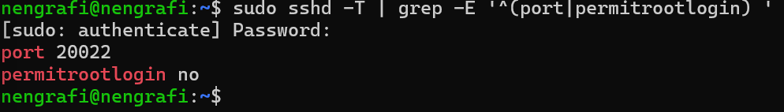
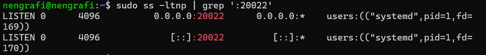
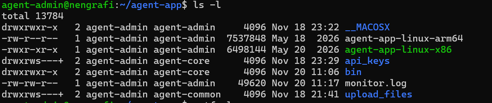
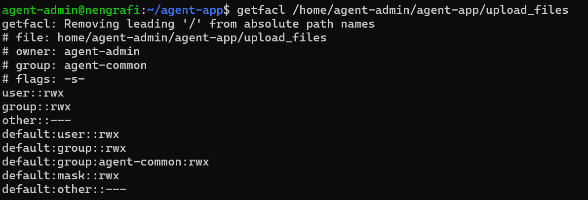
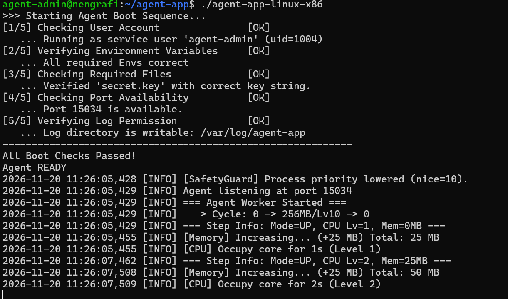
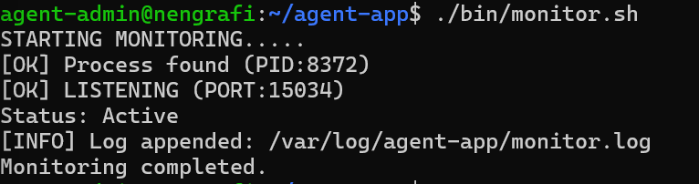
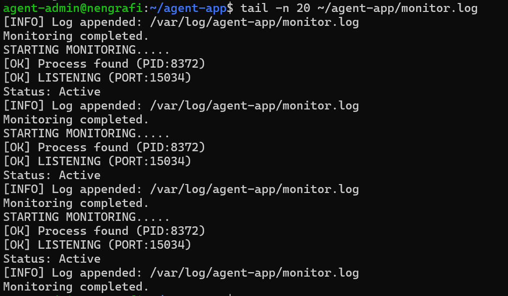

# 컴퓨터가 알아서 자기 상태를 점검하게 만들기

> **Codyssey Basic B4-1** · AI/SW 기초 · Linux와 OS<br>
> Ubuntu 22.04 LTS 환경에서 보안, 권한, 실행 환경, 모니터링을 하나의 운영 흐름으로 구성한 과제입니다.

## 1. 프로젝트 소개

서버 장애는 애플리케이션이 멈춘 뒤에 발견하면 복구 비용이 커집니다. 이 과제에서는 단순히 프로그램을 실행하는 데서 그치지 않고, **누가 서비스에 접근할 수 있는지**, **어떤 경로에 쓸 수 있는지**, **프로세스·포트·방화벽이 정상인지**를 스스로 점검하고 기록하는 환경을 만들었습니다.

핵심 목표는 다음과 같습니다.

- SSH 공격 표면을 줄이고 root 원격 로그인을 차단한다.
- 역할별 계정·그룹·ACL로 최소 권한을 적용한다.
- 서비스 실행에 필요한 경로와 포트를 환경 변수로 고정한다.
- Bash 기반 `monitor.sh`가 서비스 상태와 자원 사용량을 수집해 로그로 남긴다.
- 반복 실행할 수 있는 cron 운영 방식을 문서화한다.

## 2. 전체 구성

```text
외부 관리자
    │
    ├─ SSH :20022 ──> sshd (PermitRootLogin no)
    │
    └─ TCP :15034 ──> Agent application
                              │
agent-admin ── 실행/운영 ──────┤
agent-dev   ── 개발/스크립트 ──┤── /home/agent-admin/agent-app
agent-test  ── QA ────────────┘       ├── upload_files/  (agent-common)
                                      ├── api_keys/      (agent-core)
                                      └── bin/monitor.sh
                                                │
                                                └── /var/log/agent-app/monitor.log
```

| 구분 | 적용 내용 | 목적 |
| --- | --- | --- |
| 네트워크 보안 | SSH `20022`, root SSH 로그인 차단, UFW 허용 포트 최소화 | 무차별 대입 공격과 불필요한 노출 감소 |
| 계정·권한 | `agent-admin`, `agent-dev`, `agent-test`와 `agent-common`, `agent-core` 분리 | 역할 기반 최소 권한 적용 |
| 실행 환경 | `AGENT_HOME`, 포트, 업로드·키·로그 경로를 명시 | 실행 위치가 달라도 같은 조건으로 배포 |
| 상태 점검 | 프로세스·포트·방화벽·CPU·메모리·디스크 확인 | 장애를 빠르게 발견하고 추적 가능한 기록 확보 |

## 3. 구현 및 검증

### 3.1 SSH 보안 강화

기본 SSH 포트를 `20022`로 변경하고 `PermitRootLogin no`를 적용했습니다. 포트를 바꾸는 것만으로 공격을 막을 수는 없지만, 흔한 스캔·무차별 대입 시도를 줄이고 운영 계정으로의 접속을 강제하는 기본 방어층이 됩니다. root 계정이 직접 노출되지 않으므로, 작업 이력도 일반 운영 계정을 기준으로 남길 수 있습니다.

```bash
sudo sshd -T | grep -E '^(port|permitrootlogin) '
sudo ss -ltnp | grep ':20022'
```





### 3.2 UFW로 필요한 포트만 허용

방화벽은 활성화한 뒤 SSH용 `20022/tcp`와 애플리케이션용 `15034/tcp`만 허용했습니다. 방화벽 규칙을 애플리케이션의 실제 listen 포트와 함께 검증해야, 설정 파일에는 열려 있어도 서비스가 닫혀 있거나 반대로 불필요하게 노출되는 상황을 피할 수 있습니다.

```bash
sudo ufw status
```


### 3.3 역할 기반 계정·그룹·ACL

| 계정 | 담당 역할 | 소속 보조 그룹 |
| --- | --- | --- |
| `agent-admin` | 애플리케이션 실행, 운영, 주기 실행 담당 | `agent-common`, `agent-core` |
| `agent-dev` | 개발 및 `monitor.sh` 관리 | `agent-common`, `agent-core` |
| `agent-test` | QA·테스트 데이터 확인 | `agent-common` |

`agent-common`은 여러 역할이 협업하는 업로드 공간에만 사용하고, 키와 운영 로그처럼 민감한 자원은 `agent-core`로 분리했습니다. 이 구분 덕분에 테스트 계정이 업로드 파일은 다룰 수 있어도 API 키나 운영 로그에 접근하는 일은 막을 수 있습니다.

```text
$AGENT_HOME/
├── agent-app-linux-x86
├── api_keys/        # agent-core 전용
├── bin/             # monitor.sh
└── upload_files/    # agent-common 협업 영역

/var/log/agent-app/  # agent-core 운영 로그 영역
```



`upload_files`에는 setgid와 기본 ACL을 적용해 새 파일·하위 디렉터리도 `agent-common` 그룹 권한을 이어받도록 구성했습니다. 매번 파일을 만든 뒤 `chgrp`를 실행하지 않아도 되므로 협업 경로의 권한 일관성을 유지할 수 있습니다.

```bash
getfacl /home/agent-admin/agent-app/upload_files
```



### 3.4 애플리케이션 실행 환경

실행 환경은 경로와 포트를 코드에 흩어 쓰지 않고 아래 계약으로 관리했습니다. 키의 실제 값은 문서나 저장소에 노출하지 않습니다.

```bash
export AGENT_HOME=/home/agent-admin/agent-app
export AGENT_PORT=15034
export AGENT_UPLOAD_DIR="$AGENT_HOME/upload_files"
export AGENT_KEY_PATH="$AGENT_HOME/api_keys/t_secret.key"
export AGENT_LOG_DIR=/var/log/agent-app
```

배포 앱은 일반 계정(`agent-admin`)으로 실행합니다. 시작 시 사용자, 필수 환경 변수, 키 파일, `15034` 포트, 로그 디렉터리 쓰기 권한을 순서대로 검사하고, 다섯 단계가 모두 통과해야 `Agent READY`를 출력합니다.



### 3.5 `monitor.sh`으로 상태 수집

[`agent-app/bin/monitor.sh`](agent-app/bin/monitor.sh)는 Bash로 작성한 운영 점검 스크립트입니다. 대상 앱은 `agent-app-linux-x86`, 대상 포트는 `15034`, 지표 로그 경로는 `/var/log/agent-app/monitor.log`로 설정했습니다.

| 점검 항목 | 방식 | 이상 시 동작 |
| --- | --- | --- |
| 프로세스 | `pgrep -fo agent-app-linux-x86` | 프로세스가 없으면 오류 종료 |
| 포트 | `ss -lntH`에서 `15034` LISTEN 확인 | 포트가 없으면 오류 종료 |
| 방화벽 | UFW 서비스 활성 상태 확인 | 운영자가 즉시 확인할 수 있도록 상태 출력 |
| CPU | `/proc/stat`을 1초 간격으로 비교 | `20%` 이상이면 경고 |
| 메모리 | `free -m` | `10%` 이상이면 경고 |
| 루트 디스크 | `df -P /` | `80%` 이상이면 경고 |

정상 점검 결과는 시간, PID, CPU, 메모리, 디스크 사용률과 함께 지표 로그에 추가됩니다. 헬스 체크를 먼저 통과시킨 뒤 자원을 기록하므로, 죽어 있는 서비스의 수치를 정상으로 오해하지 않습니다.

```bash
cd "$AGENT_HOME"
./bin/monitor.sh
```



표준 출력은 별도 실행 이력으로도 남겨 반복 실행 여부를 확인했습니다. 아래 화면은 프로젝트 내부 `monitor.log`에 모인 실행 결과입니다. 이는 `/var/log/agent-app/monitor.log`의 원본 지표 로그와 용도가 다른 운영 확인용 출력 기록입니다.



## 4. 실행과 재검증 방법

서비스는 root가 아닌 `agent-admin`으로 실행합니다. 애플리케이션과 모니터를 각각 다른 터미널에서 실행하면 상태 변화를 바로 확인할 수 있습니다.

```bash
# 터미널 1: agent-admin
export AGENT_HOME=/home/agent-admin/agent-app
cd "$AGENT_HOME"
./agent-app-linux-x86

# 터미널 2: agent-admin
cd "$AGENT_HOME"
./bin/monitor.sh
tail -n 20 /var/log/agent-app/monitor.log
```

다음 명령으로 보안과 권한도 함께 재검증합니다.

```bash
sudo sshd -T | grep -E '^(port|permitrootlogin) '
sudo ss -ltnp | grep ':20022'
sudo ufw status

id agent-admin
id agent-dev
id agent-test
getfacl "$AGENT_HOME/upload_files"
```

### cron 등록 방식

주기 실행은 `agent-admin`의 crontab에 절대 경로로 등록합니다. cron은 로그인 셸보다 환경 변수가 적으므로, 상대 경로나 사용자 셸 설정에 의존하지 않는 것이 중요합니다.

```cron
* * * * * /home/agent-admin/agent-app/bin/monitor.sh >> /home/agent-admin/agent-app/monitor.log 2>&1
```

등록 후에는 아래처럼 1~2분 뒤 로그 줄 수가 늘어나는지 확인합니다.

```bash
crontab -l
sleep 70
tail -n 20 /home/agent-admin/agent-app/monitor.log
```

## 5. 요구사항 점검표

| 요구사항 | 구현·검증 근거 |
| --- | --- |
| SSH 포트 변경 및 root 직접 접속 차단 | `sshd -T` 결과가 `port 20022`, `permitrootlogin no`; 이미지 1 |
| 변경 SSH 포트 LISTEN | IPv4·IPv6 `:20022` LISTEN; 이미지 2 |
| 방화벽 최소 허용 | UFW active, `20022/tcp`와 `15034/tcp` 허용; 이미지 3 |
| 계정·그룹 분리 | 세 계정의 보조 그룹 확인; 이미지 3 |
| 디렉터리·ACL 분리 | `api_keys`는 `agent-core`, `upload_files`는 `agent-common` 및 기본 ACL; 이미지 4~5 |
| Boot Sequence | 5개 점검 단계 모두 `[OK]`, `Agent READY`; 이미지 6 |
| 프로세스·포트·방화벽 모니터링 | PID, `15034` LISTEN, UFW active와 로그 추가 확인; 이미지 7 |
| 반복 실행 이력 | 모니터 출력 누적 확인; 이미지 8 |

## 6. 운영 시 유의 사항과 다음 개선

- `monitor.sh`에는 `MAX_LOG_SIZE=10MB`, `MAX_LOG_FILES=10` 상수가 선언되어 있지만, 현재 저장소의 스크립트만으로는 실제 로테이션 수행까지 확인되지 않습니다. 운영 배포 전에는 `logrotate` 또는 명시적인 Bash 로테이션 로직을 추가하고, 10MB 초과·10개 보관 테스트를 남겨야 합니다.
- 현재 `check_state`는 UFW가 비활성일 때 오류 종료합니다. 과제 요구처럼 방화벽 상태를 **경고만** 내고 CPU·메모리·디스크 수집은 계속하려면 `error_exit` 대신 `warning`을 사용하도록 조정해야 합니다.
- 이미지 6의 Boot Sequence는 `secret.key`를 확인한다고 표시하지만, 과제 환경 변수 예시는 `t_secret.key`를 가리킵니다. 제출 전에는 제공된 실행 파일이 실제로 요구하는 파일명과 `AGENT_KEY_PATH`를 일치시켜야 합니다.
- 현재 저장소와 캡처에는 `crontab -l` 결과가 별도 증거로 포함되어 있지 않습니다. 위 등록 방식으로 설정한 뒤 실제 1분 단위 누적 화면을 추가하면 자동 실행 요구사항을 더 명확하게 입증할 수 있습니다.
- 초기 실행 이력에는 경로, 실행 권한, Bash 문법, UFW 권한 관련 실패가 남아 있습니다. 이 시행착오는 절대 경로 사용, 일반 계정 실행, 시작 전 포트·권한 검증이 왜 필요한지를 보여주는 자료가 되었습니다.
- 보너스 과제인 기간별 `report.sh` 통계와 장기 보관 아카이브는 이 저장소의 검증 범위에 포함하지 않았습니다.

## 7. 회고

이번 과제에서 가장 중요한 점은 설정 하나를 바꾸는 것이 아니라 **보안 설정 → 권한 경계 → 애플리케이션 검증 → 지속 모니터링 → 로그 추적**을 끊기지 않는 흐름으로 연결한 것이었습니다. 특히 공유 업로드 영역과 민감 영역을 ACL·그룹으로 분리하고, 서비스 상태를 사람이 매번 직접 보지 않아도 기록으로 남기게 만든 경험은 실제 서버 운영의 기본 단위를 이해하는 데 도움이 되었습니다.
